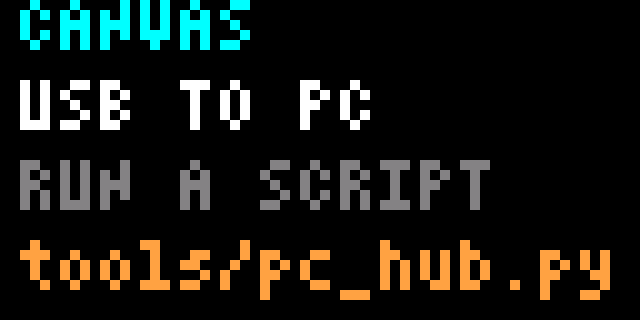
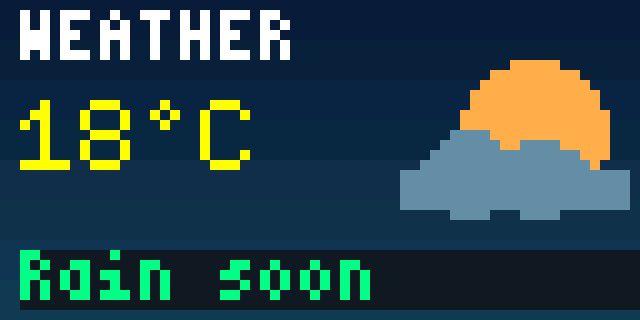
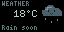

# Canvas: serial backgrounds and named text

Canvas displays a still or streamed background with up to eight independently
updated text boxes. Define positions once in a JSON layout, then address boxes by
name. The computer converts images; the device retains and composites the layers.
There is no firmware rebuild for a new layout.
For a ready-to-run PC dashboard, see the [PC stats hub](PC-HUB.md).
For an idle character that exercises harder as CPU/GPU load rises, run
`tools/run.py companion`; see [Pixel Companion](PIXEL-COMPANION.md).

Before the first scene upload after boot, Canvas shows setup instructions:
connect its USB data port to a PC and run a provided script, with
`tools/run.py dashboard` as an example. Info requests and invalid packets retain this
message. Any valid background/layout/text/style upload replaces it, including an
intentional black background or empty layout. Disconnecting does not bring it
back or cover retained content. This is a first-use hint, not USB-link detection.





## Try it without hardware

The helper requires Python 3.12 or later. Pillow handles images; pyserial handles
serial ports. The protocol and simulator connection use the standard library.
From the repository root:

```sh
python3 -m venv .venv
. .venv/bin/activate
pip install -r tools/requirements.txt
cargo run -p simulaitor -- --canvas-listen 127.0.0.1:7777
```

In another terminal, using the same Python environment:

```sh
python3 tools/run.py canvas --port tcp://127.0.0.1:7777 layout tools/displaitor_tools/resources/layouts/weather.json
python3 tools/run.py canvas --port tcp://127.0.0.1:7777 fill '#103050'
python3 tools/run.py canvas --port tcp://127.0.0.1:7777 --layout tools/displaitor_tools/resources/layouts/weather.json text temperature '21°C'
python3 tools/run.py canvas --port tcp://127.0.0.1:7777 --layout tools/displaitor_tools/resources/layouts/weather.json style temperature --color '#B8C8C0' --background '#000000'
```

The simulator's `--canvas-listen` option locally opens Canvas. The endpoint binds
only to a loopback IP. For a timed headless run with a final real-renderer capture:

```sh
cargo run -p simulaitor --no-default-features -- --headless --canvas-listen 127.0.0.1:7777 --frames 3000 --snapshot target/canvas.ppm
```

Headless Canvas sleeps 10 ms per update; this is a simulator convenience, not an
RP2040 performance measurement. Ordinary smoke mode remains deterministic.

## Layout and text

The weather example uses black text boxes with muted grey/mint foregrounds for
the LED panel. Its initial values are a layout example, not a live weather feed.
For cute animations driven by its bottom condition text, run
`python tools/run.py weather --status 'Rain soon'`. For live wttr.in weather and
D-pad views, run `python tools/run.py weather` instead. See the [animated weather app](WEATHER.md)
for rain, sun, clouds, snow, fog, storms and clear nights.



`tools/displaitor_tools/resources/layouts/weather.json` is a complete example:

```json
{
  "text": {
    "temperature": {
      "x": 2, "y": 9, "width": 36, "height": 10,
      "font": "medium", "align": "right", "color": "#B8C8C0", "background": "#000000",
      "text": "18°C"
    }
  }
}
```

- Coordinates are logical pixels from the top left. The existing board adapter
  handles the panel's 180-degree orientation.
- Colours stay logical RGB in layouts and uploads. The board adapter compensates
  for the connected panel's green/blue reversal; the simulator needs no compensation.
- Fonts are `small` (4×6), `medium` (6×10), and `large` (10×20).
- `align: "right"` reserves all complete character cells in a fixed-width box.
  The helper pads both initial and later text with spaces, keeping numeric
  suffixes and units anchored. For example, a 24-pixel medium box fits `  1%`
  through `100%`. The weather box reserves six medium cells, so `18°C` and
  `-18°C` keep their digits and `°C` in the same positions. The default is
  `"left"`. Right-aligned values that exceed the box are rejected before upload;
  shorten the reading or enlarge the box instead of silently clipping it.
- `color` sets the glyph foreground using `#RRGGBB`, quantized to RGB565.
- `background: null`, an omitted background, or `"transparent"` leaves the image
  and earlier text layers visible between glyphs. A colour fills the **whole box**
  before drawing its text. There is no fractional alpha.
- `width` defaults to the remaining screen width. `height` defaults to the font
  height, clipped to the remaining screen height. Explicit boxes must fit on screen.
- Text is a single clipped line, without wrapping or automatic scrolling.
  Printable Latin-1 is accepted as UTF-8 (including `°`, `é`, `ä`), up to 64 bytes
  per slot. Unsupported characters, newlines and overlong strings are rejected.
- JSON insertion order is drawing order; later boxes cover earlier ones.

The `layout` command atomically replaces all text boxes and their initial text,
while retaining the background. `--layout` loads the local name mapping for a
later command and **does not upload** or reset anything. A layout identifier
includes box definitions, their order, names and initial text. A mismatched
reference is rejected; re-upload a changed layout before using it.

`text NAME ''` clears the glyphs. An opaque box remains until its background is
made transparent or the layout removes it. Every redraw starts from the retained
background, so replacing a long value with a short one leaves no stale pixels.
Text and style changes do not change the layout identifier.
Alignment is a host layout policy and is included in that identifier. It uses
ordinary space-padded text packets, so no firmware update is needed. Use the
matching local layout for later named updates, including CLI commands.

For one logical update involving multiple commands, use a transaction:

```python
with display.transaction():
    display.background("clouds.png")
    display.text("temperature", "21°C")
    display.style("temperature", color="#B8C8C0", background="#000000")
    display.show()
```

The previous complete scene remains visible until Commit. Nested transactions
join the outer scope; an operation failure poisons the entire transaction even
if its exception is caught inside the scope. Abort restores the host's previous
name mapping. A transport failure closes the client because a lost Commit reply
cannot establish whether publication occurred; reconnect and install a complete
scene. PC hub and Pixel Companion use transactions for installation and updates.
Start `streaming()` outside transaction scopes; its worker cannot join a
transaction owned by the calling thread, so that nesting is rejected.

Current helpers require firmware with transaction support and report an update
requirement for older firmware. Existing older clients can still send commands
0–6 to current firmware; those commands remain immediate outside a transaction.

## Images and streaming

```sh
python3 tools/run.py canvas --port tcp://127.0.0.1:7777 background clouds.png
python3 tools/run.py canvas --port tcp://127.0.0.1:7777 stream clouds.gif --fps 20 --repeat
```

The helper accepts Pillow-supported still and animated image files, or a sequence
of files. `--fit contain` (default) preserves aspect ratio with black padding;
`cover` crops; `stretch` fills the screen. Image alpha is flattened over black.
One frame is 4,096 raw little-endian RGB565 bytes. V1 intentionally uses no image
compression; `--fps` is a requested ceiling, and acknowledged transfer speed can
reduce it. Animation file timing is replaced by this fixed requested frame rate.

One client owns a connection at a time. To stream and update text concurrently,
use one shared Python client. `streaming` owns a worker and stops it on exit;
packet exchanges are serialized so background and text bytes cannot interleave:

```python
from tools.canvas import Client

with Client("tcp://127.0.0.1:7777") as display:
    display.layout("tools/displaitor_tools/resources/layouts/weather.json")
    with display.streaming("clouds.gif", fps=20):
        display.text("temperature", "21°C")
        display.style("temperature", color="#B8C8C0", background="#000000")
        display.text("status", "Rain soon")
        input("Press Enter to stop the background stream...")
```

For integrations that already produce pixels, `display.frame(bytes)` accepts an
exactly sized RGB565 frame. `display.background(path)` sends one image;
`display.fill(color)` replaces the background with a solid colour. These preserve
all text. `display.stream(paths, ...)` is the blocking variant.

## Firmware transport and local controls

Host apps can also [read debounced buttons and retained press/release events](CANVAS-BUTTONS.md)
through `display.buttons()` on the same connection. The companion uses these for
pet switching and a short action; Back and Select retain their local behavior.

Firmware implements **native RP2040 USB CDC-ACM**, using the existing USB
peripheral and no general-purpose GPIO changes. This branch uses `embassy-rp
0.10.0` and `embassy-usb 0.6.0` on a priority interrupt executor. The development
VID/PID remains `16c0:27dd`, with product `Displaitor Canvas`; the shared example
IDs are not a dedicated production allocation. Device and CDC state stay within
one task, with bounded packet/reply channels to the UI-owned parser. See
[runtime ownership](RUNTIME-ARCHITECTURE.md) and the pinned
[CDC implementation](https://docs.rs/embassy-usb/0.6.0/embassy_usb/class/cdc_acm/index.html).

USB session service requires asserted DTR, as supplied by the Python serial
client. DTR loss or USB deconfiguration aborts unpublished content. TCP simulator
disconnect does the same. A fresh helper also sends Abort to recover from serial
close/reopen events the device could not observe.

With the board's USB data connection available, the helper takes an explicit
device path in `--port` instead of the simulator
URL. It never discovers or opens ports automatically. The probe's SWD connection
does not provide this native USB data path; probe UART is not implemented.
The `--baud` option configures a host serial port, but native USB CDC pixel
transfers do not run at that UART baud rate.

Select **Canvas** in Home to display uploaded content, or run
`python3 tools/run.py canvas --port YOUR-DEVICE show` (`display.show()` in scripts).
The explicit Show command selects Canvas once through the normal UI update path,
stopping prior app audio and requesting a redraw. An already-open Canvas stays
intact. B pressed in the same update takes priority. Reception also works while
another screen is active; ordinary content updates never change screens. B returns to the actual
originating menu with its cursor retained. Canvas content survives leaving the
app, a host disconnect and a USB reset while power remains; a device reboot clears
it. Disconnection freezes the latest complete background and text. Animation
requires the sending computer. There is no flash persistence or button forwarding.

Core 0 polls USB on every foreground loop, including while a HUB75 frame swap
is pending. Swaps do not block application updates; timer-driven button sampling
also continues during drawing. Each USB service pass reads at most 512 bytes and
stops when a reply is pending.
USB hardware and the CDC buffers provide backpressure; no unbounded frame queue
or long critical section is introduced. Rendering, packet validation and panel
swap latency need their own timing measurements. Native uploads, concurrency and
the resulting hardware framebuffers passed [Linux board tests](HARDWARE-CANVAS-USB.md).

## Wire protocol v1

All multibyte integers are little-endian. Encode each complete packet with COBS,
then append a zero byte. Before COBS, a request is:

```text
version:u8=1 | command:u8 | sequence:u16 | payload | CRC32:u32
```

CRC32 is the standard reflected IEEE CRC32 (as in Python `zlib.crc32`) of the
header and payload, excluding the CRC itself. The decoded packet is at most
4,104 bytes; encoded data is at most 4,121 bytes plus the delimiter. The receiver
stores a complete packet, decodes in place and validates it before changing the
scene. The packet storage also serves as background staging, avoiding another
4 KiB allocation.

| Command | Payload |
| --- | --- |
| 0 Info | Empty |
| 1 Background | Exactly 4,096 RGB565 bytes, row-major, top-left first |
| 2 Layout | `layout_id:u32`, `name_salt:u32`, `count:u8`, then `count` records |
| 3 Text | `layout_id:u32`, `slot:u8`, followed by 0–64 UTF-8 bytes |
| 4 Style | `layout_id:u32`, `slot:u8`, `foreground:u16`, `opaque:u8`, `background:u16` |
| 5 Fill background | `color:u16` |
| 6 Show Canvas | Empty; explicitly request Canvas activation on the next UI update |
| 7 Begin | Empty; copy visible scene into staging, replacing abandoned staging |
| 8 Commit | Empty; publish a successful staged scene and its deferred Show |
| 9 Abort | Empty; discard staging and deferred Show; safe without a transaction |
| 10 Buttons | Empty baseline or `after_id:u32`; [button report response](CANVAS-BUTTONS.md#wire-extension) |
| 11 Companion cry | One byte: 0 stop, 1 Torchic, 2 Eevee, 3 Treecko; [sound semantics](CANVAS-BUTTONS.md#companion-sound-extension) |

A layout record is `slot:u8, x:u8, y:u8, width:u8, height:u8, font:u8,
foreground:u16, opaque:u8, background:u16, text_length:u8, text_bytes`.
Slot IDs are 0–7 and unique; font IDs 0/1/2 select small/medium/large.
`opaque` is exactly 0 or 1. Drawing always follows slot ID order. The helper assigns
IDs in JSON insertion order. `name_salt` is CRC32 of the UTF-8 JSON name array
serialized with `ensure_ascii=False` and `separators=(",", ":")`.
`layout_id` is CRC32 of the entire payload after its first four bytes.
These checks detect stale references and corruption; they are not authentication.

Structurally valid requests with a valid CRC receive a COBS-framed response.
Commands 0–9 and 11, and errors for command 10, retain this ordinary ACK:

```text
1:u8 | 0x80:u8 | sequence:u16 | status:u8 | 64:u8 | 32:u8 |
8:u8 | 64:u8 | current_layout_id:u32 | CRC32:u32
```

Status 0 means accepted; 2 unsupported version; 3 unknown command; 4 invalid
value/unconfigured slot; 5 mismatched layout; 6 invalid text; 7 missing or failed
transaction. Status 1 is reserved. During a transaction, reply layout IDs describe
the staged scene; rendering and `Canvas::layout_id()` describe the visible scene.
Rejected commands poison an open transaction; Commit then fails until Begin or
Abort. Show is deferred until Commit. A transaction uses one additional fixed
scene buffer; packet framing and maximum packet size are unchanged.
Invalid COBS, oversized/truncated envelopes and CRC failures are discarded without
an acknowledgement because the sequence cannot be trusted. The next delimiter
resynchronizes reception. Reconnection sends a leading delimiter.

Send **one request, wait for its reply**, then send the next. A pending response
blocks further reads until drained, including partial writes. On timeout the
helper raises an error without automatically retrying; reconnect before retrying.
All mutations are absolute assignments, but re-uploading a layout resets its
initial text and styles. The acknowledgement means the scene accepted a command,
or queued Show, not that a physical scanout or screen transition finished. Several updates may coalesce before the
next display redraw.

## Verification

`./scripts/check.sh` includes Rust scene/protocol tests and Python-to-simulator
tests, strict host/ARM Clippy, smoke tests and offline firmware linking. New tests
cover complete-frame commit, CRC failures, overflow/resynchronization, partial
packets/replies, malformed layouts, all font sizes and maximum slot/text limits,
transparency/colours, shorter text, stale IDs, disconnect/reconnect, concurrent
background/text updates and actual rendered pixels. Canvas work is compared at
menu depths 1/16/64/128. See [VALIDATION.md](VALIDATION.md) for measured evidence
and the boundary between simulator checks and hardware validation.

Authorized SWD testing has since programmed and readback-verified the production
firmware, exercised local navigation, and rendered a retained Canvas test scene
on the RP2040 with a completed framebuffer swap. Test data was injected into RAM
over SWD; this did not exercise serial reception. The board was left running the
test card with the debugger detached. That check did not test native USB; later
[native USB hardware tests](HARDWARE-CANVAS-USB.md) passed app uploads, streaming,
transaction/session recovery and actual framebuffer comparisons. the user's
initial photograph confirmed the visible layout and transparent/opaque text boxes,
and he subsequently confirmed the corrected panel colours looked good; see
[connected-board evidence](VALIDATION.md#connected-board-checks).


### Windows COM read timeout

Serial reads use a fixed timeout of at most 50 ms, configured once when opening
the port. The reply parser never assigns `Serial.timeout`: pyserial's setter
reconfigures an open COM port even when the value is unchanged. Guarding the
assignment with an equality check is insufficient because it still reconfigures
the port as the overall deadline approaches.
An empty short read keeps waiting for the same reply, preserving partial COBS
frames until the configured overall acknowledgement deadline (default 3 s).
The final polling read can exceed that deadline by at most one read interval;
deadlines below 50 ms select their shorter fixed interval at open time.
The write timeout still uses that configured deadline. TCP timeouts and EOF
handling are unchanged. This avoids long blocking COM reads without treating a
normal gap between USB packets as a failed command. Host-only regression tests
use pyserial's real property setter and simulate fragmented replies, ACKs in the
last polling interval, missing ACKs and deadlines below 50 ms. They assert that
no serial reconfiguration occurs after open. Physical Windows USB operation
still needs checking.

## Host output gamma

The Python SDK automatically applies gamma 2.8 on serial/USB connections, covering
background frames, initial text colours, style changes and fills. TCP connections
retain identity output for desktop simulators. All live apps and the Canvas CLI
accept `--gamma`; use `--gamma 1` to disable correction. Raw `color565()` and
`image_frame()` remain logical RGB565 encoders, so assets/previews are not
corrected twice. See [colour output and calibration](COLOR-OUTPUT.md).
