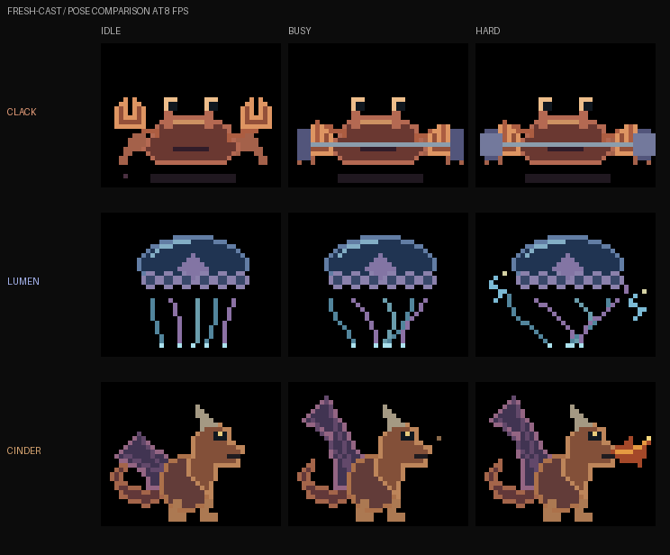
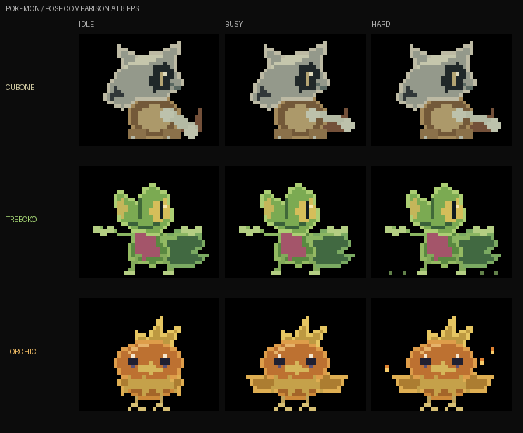

# New companion casts

The revised [Pokémon play loops and Monster Hunter-inspired set](COMPANION-PLAY.md)
are the latest studies. This page preserves the earlier creature and Pokémon
movement comparisons.

Two separate sets for choosing. Each has three characters, three activity states
and 16 frames per state. All use the existing 40×32 character region, RGB565
colours, sparse highlights and a black background. These are offline previews;
the current live sender still uses its selected original characters.

## Fresh creatures

Different silhouettes and behaviours, with weightlifting only for the crab.

| Character | Idle | Working | High load |
| --- | --- | --- | --- |
| **Clack**, crab | Eye-stalk blinks, relaxed claws and small leg movements | Claw-driven barbell presses and scuttling | Heavier plates and stronger body movement |
| **Lumen**, jellyfish | Floating umbrella and drifting tentacles | Larger contractions and tentacle sweeps | Tighter contractions, wide tentacles and electrical sparks |
| **Cinder**, dragon | Side-view breathing, folded wing and curled tail | Broad wingbeats and small puffs | Wingbeats with an orange fire jet |



[Static gallery](ui/companions/fresh-cast/preview.png) ·
[Labelled sheet: all 144 frames](ui/companions/fresh-cast/sprite-sheet-labelled.png) ·
[Native 640×288 sheet](ui/companions/fresh-cast/sprite-sheet.png)

## Pokémon

Original pixel interpretations with character-specific activities.

| Character | Idle | Working | High load |
| --- | --- | --- | --- |
| **Cubone** | Breathing and a resting bone | Large bone swings up beside its skull | Faster swings, stronger movement and impact flecks |
| **Treecko** | Blink, gentle sway and tail movement | Leaps with raised hands and a sweeping tail | Higher leaps, lateral movement and landing flecks |
| **Torchic** | Folded wings, blink and small breathing movement | Hops and wide wing flaps | Higher hops, stronger flaps and rising embers |



[Static gallery](ui/companions/pokemon/preview.png) ·
[Labelled sheet: all 144 frames](ui/companions/pokemon/sprite-sheet-labelled.png) ·
[Native 640×288 sheet](ui/companions/pokemon/sprite-sheet.png)

Character shapes were checked against official reference artwork:
[Cubone](https://assets.pokemon.com/assets/cms2/img/pokedex/full/104.png),
[Treecko](https://assets.pokemon.com/assets/cms2/img/pokedex/full/252.png),
[Torchic](https://assets.pokemon.com/assets/cms2/img/pokedex/full/255.png).
The sprites and activity poses are drawn in project code; downloaded references
are local review inputs, not shipped assets.

## Files and regeneration

Each gallery has characters in rows and idle/work/hard in columns. Galleries
play every state at 8fps to compare poses. Individual `character-state.gif` files
use 3/8/12 animation steps per second. Each native sprite sheet has 16 columns
and nine rows: the first character's idle/work/hard, followed by the next two.
Native cells are 40×32 pixels with no HUD. Enlargements use nearest neighbour.

From the repository root, with the existing Canvas Python dependencies:

```sh
.venv/bin/python tools/run.py preview collections
# Or regenerate only one set:
.venv/bin/python tools/run.py preview collections --collection pokemon
```

The generator needs no simulator, serial connection or board. All draw
coordinates were checked against the 40×32 region; every native cell matches
its RGB565 source frame, and all source frames keep the right 24 HUD columns
black. All three states have distinct poses. GIF dimensions, looping and timing
were checked, and both full labelled sheets were visually inspected. No choice
has been applied to the sender or firmware.
