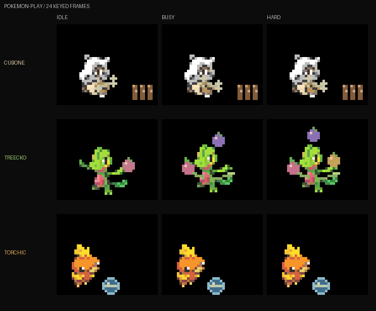
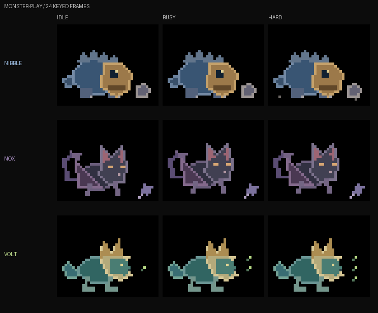

# Companion play studies

Two new sets with objects, contact and reactions. Each scene has 24 native frames
in a 40×32 character/play area; the 24-column Canvas HUD region stays black.
These are selection previews, separate from the live sender. The previously
preferred jellyfish remains available in the [fresh cast](COMPANION-COLLECTIONS.md#fresh-creatures).

## Pokémon play iteration



| Character | Idle | Working | High load |
| --- | --- | --- | --- |
| **Cubone** | Holds and gently moves its bone beside the pins | Winds up, bowls, walks to retrieve the bone, returns | Faster loop, all three pins fall, stronger steps and impact flecks |
| **Treecko** | Balances and rolls a berry in its hand | Juggles two berries with timed hand flicks and a low return pass | Three differently coloured berries and a tail-assisted return |
| **Torchic** | Gently taps the toy ball | Kicks, follows and hops as the ball rolls back | Higher hop and a few warm embers |

Cubone's ready/wind-up is frames 0–3; the throw and roll are 4–7; the pins fall
at 8; it approaches and picks up the bone during 9–15, returning during 16–23.
Pins reset for the next round. Treecko's airborne arcs finish at the hands and
connect to lower return passes. Torchic makes toe contact before the outward
roll, then hops during the return. The props follow the throw, catch and
recovery poses.

[Static gallery](ui/companions/pokemon-play/preview.png) ·
[All 216 frames, labelled](ui/companions/pokemon-play/sprite-sheet-labelled.png) ·
[Native 960×288 sheet](ui/companions/pokemon-play/sprite-sheet.png)

The character bases are native-resolution game icons distributed by
[PokéAPI/sprites](https://github.com/PokeAPI/sprites), with source attribution,
pinned revision and hashes in [the source notes](../tools/displaitor_tools/resources/art/pokemon-icons/README.md).
They retain recognisable proportions without rescaling. Poses, props, sequencing
and matrix colour adjustment are project code. The upstream image copyright
attribution to The Pokémon Company is retained; these are unofficial studies.

## Monster Hunter-inspired creatures



Original creature interpretations: low four-legged silhouettes, scales, wing
membranes, horns, manes and expressive animal behaviour. No humans, outfits or
humanoid bodies. Natural props keep the scenes focused on the creatures.

| Character | Personality and play | Activity progression |
| --- | --- | --- |
| **Nibble**, rock-gobbler | A broad blue body, heavy orange jaw and small feet; noses and catches a pebble | Watches the pebble, nudges it, follows and catches its return with a contented blink |
| **Nox**, winged night-cat | Long ears, folded foreleg membranes and a tufted tail; stalks a feather | Crouches, pounces, bats the feather upward with its paw and settles |
| **Volt**, thunder-pup | Teal scales, cream mane and gold horns; follows glowbugs | Watches one bug, bounds after two, then chases three with small sparks in its mane |

[Static gallery](ui/companions/monster-play/preview.png) ·
[All 216 frames, labelled](ui/companions/monster-play/sprite-sheet-labelled.png) ·
[Native 960×288 sheet](ui/companions/monster-play/sprite-sheet.png)

## Export and checks

From the repository root, with the Canvas Python dependencies:

```sh
.venv/bin/python tools/run.py preview play
# Regenerate either set alone:
.venv/bin/python tools/run.py preview play --cast pokemon-play
.venv/bin/python tools/run.py preview play --cast monster-play
```

The galleries play every activity at a common nominal 8fps for comparing poses.
Individual character GIFs use 3/8/12 steps per second for idle/work/hard, with GIF
centisecond rounding. Identical hold frames can be merged by the GIF encoder;
their durations are retained. Native PNG sheets contain all 24 source frames.
Each native sheet has nine rows and 24 columns of 40×32 cells. The labelled sheet
splits each row into frames 0–11 and 12–23 to keep the pixels readable.

Raster-level regressions check the bone's movement and pin/reset states, two vs
three berries, ball return and Torchic's hop, and paw-to-feather contact. Separate
export checks compare every native cell with its RGB565 source, verify GIF sizes,
looping and timing, and assert all drawing coordinates fit in 40×32. No firmware,
hardware connection or live companion selection is needed to generate these.
