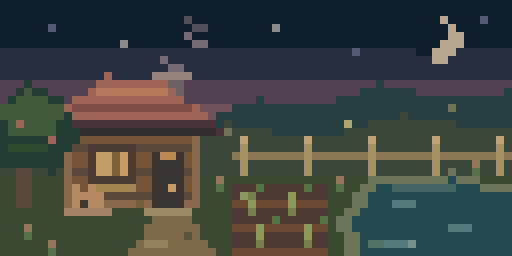
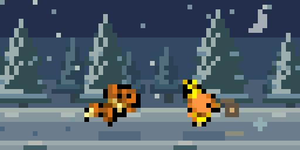
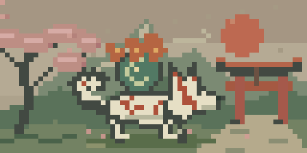
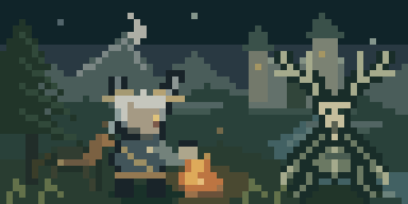
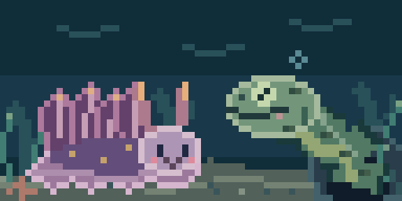
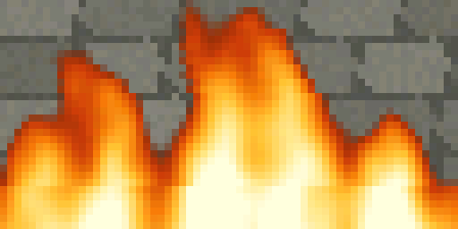
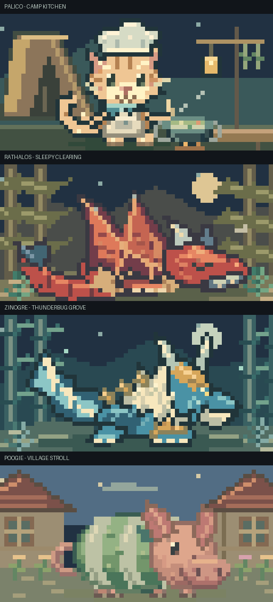
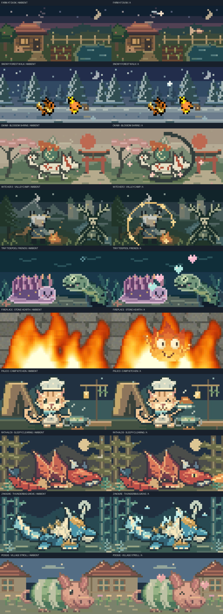
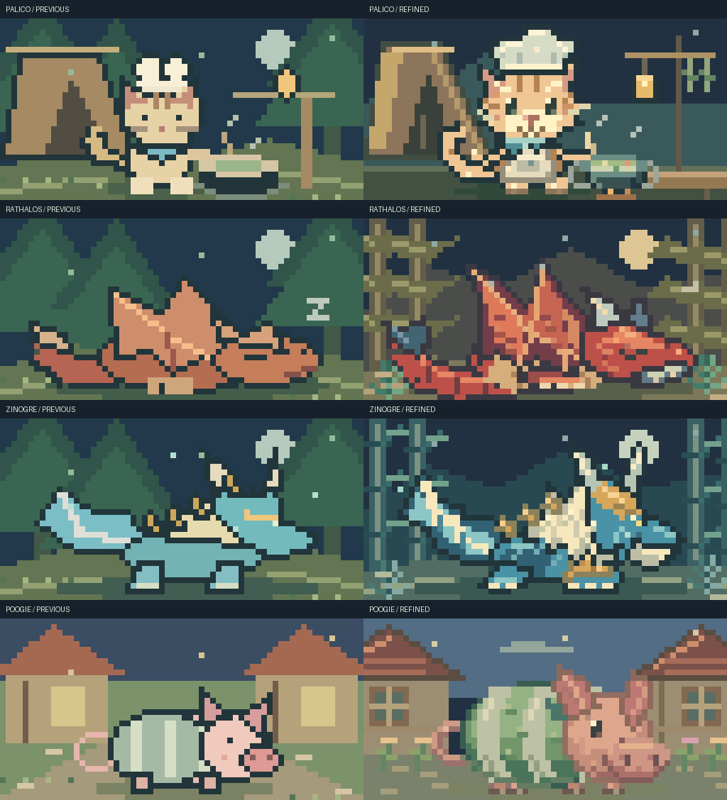
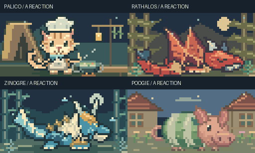

# Cozy fullscreen scenes

Ten animated scenes fill the whole 64×32 panel: Farm, Snow Walk, Ōkami,
Witcher, Reef, Fireplace, Palico, Rathalos, Zinogre and Poogie. All ten are built into the default firmware and
also available through the Python sender.

## Built-in apps

Open **Home → Watch**, then choose **Fireplace**, **Farm dusk**, **Snow walk**,
**Blossoms**, **Valley camp**, **Tidepool**, **Palico**, **Rathalos**, **Zinogre** or **Poogie**. These run without USB, a PC or a
Python process. Left/Right cycles Farm → Winter → Ōkami → Witcher → Reef →
Fireplace → Palico → Rathalos → Zinogre → Poogie, wrapping both ways.
A triggers a short scene-specific reaction; Up pauses and Down resumes; B returns to Watch with its
selection preserved. Switching scenes preserves pause. Nyankatz and Hyperspace
remain separate Watch entries.

Python owns the artwork. A generator bakes deduplicated, 10fps QOI clips into
Flash (1,900,336 bytes for the ten ambient clips, plus sparse action overlays). The decoder borrows only the current compressed
frame and draws directly into the existing back buffer. There is no heap or
extra animation framebuffer. Identical frames share storage and do not request
redundant redraws. A paused scene without an active A reaction has no periodic UI deadline. All scenes are
silent. Native output applies gamma 2.8 at the physical panel adapter; Canvas
bypasses that lookup because the Python SDK already applies its output profile.

```sh
# Build firmware only; does not flash or contact hardware:
cargo build --locked -p aitos --features firmware --target thumbv6m-none-eabi --release
# Direct native preview of the same built-in apps, without a host sender:
cargo run -p simulaitor -- --cozy farm
cargo run -p simulaitor -- --cozy winter
# Rebuild/check the firmware media after editing the Python artwork:
python tools/run.py assets cozy
python tools/run.py assets cozy --check
```

The linked firmware is `target/thumbv6m-none-eabi/release/aitos`. Follow the repo's
requirement to run `cargo clean` when switching between ARM and native builds.
Normal RAM-code builds keep the large scene media in Flash.

## Python sender

The host version remains available with Python 3.12+. Run the separate script,
or use the shared tools launcher:

```sh
python -m pip install -r tools/requirements.txt
python tools/cozy.py --scene farm
python tools/cozy.py --scene winter
python tools/cozy.py --scene okami
python tools/cozy.py --scene witcher
python tools/cozy.py --scene reef
python tools/cozy.py --scene fire
# Equivalent unified command, with an explicit Windows COM port:
python tools/run.py cozy --scene winter --port COM6
# Windows launcher uses the checkout's .venv when available:
# tools\cozy.cmd --scene winter --port COM6
```

`--port auto` selects native USB. Run only one host app on that connection.
USB output automatically applies gamma 2.8; `--gamma 1` disables it and
`--gamma 2.2` selects a gentler curve. TCP previews default to uncorrected RGB.
See [colour output](COLOR-OUTPUT.md).
The sender works with existing Canvas firmware. The built-in menu apps require
the updated firmware.
The Python sender and built-in firmware use the same ten-scene rotation.

## Farm at dusk

A small original scene inspired by Stardew Valley's quiet evenings: a timber
cottage with warm window light, a curled-up cat, a vegetable patch, an orchard
tree, a pond and a fence disappearing into the hills. Smoke drifts from the
chimney, pond ripples catch the light, leaves sway and fireflies wander through
the twilight. The cottage, camera and path stay fixed.



## Snowy forest walk

A side-scrolling scene inspired by the winter journey in Pokémon Mystery Dungeon:
Red Rescue Team. Torchic and Eevee walk together along a snowy trail beneath
moonlit pines. Background trees scroll at different speeds, footprints recede
behind the party, two layers of snow drift past, and a small lantern adds warmth.
The companions keep their spacing and their feet anchored to the trail.



The farm and forest scenery are drawn locally in Python. Winter companions reuse
the already bundled, attributed [Mystery Dungeon walk sheets](../tools/displaitor_tools/resources/art/rescue-pets/README.md)
at half size with nearest-neighbour sampling. There are no runtime downloads.

## Ōkami: blossom shrine

A parchment-toned ink-wash landscape with a red sun, layered mountains, a
blossoming cherry tree and a red torii gate. Amaterasu fills the foreground with
white fur, pointed ears, red markings and a flaming Divine Reflector. Her paws
step gently, her brush tail curls and her eyes blink. Flame tips breathe, wind
ribbons drift and cherry petals float behind her, leaving her face readable.
The path and shrine stay fixed. All artwork is drawn locally in Python.



## Witcher 3: valley camp

A quiet moonlit camp beneath a Kaer Morhen-inspired keep. Geralt rests beside a
small fire with his two swords, warming his hands and occasionally sipping from
a travel cup. An antlered woodland leshen sways gently on planted root feet:
pale skull, branching antlers, bark armour and long twig fingers. Roach grazes
nearby. Flames and embers move locally, mist drifts across the valley, river
ripples catch the moonlight and grass sways. The camera stays still. This is
original Python-drawn pixel art.



## Tiny tidepool friends

An original underwater scene with a lavender nudibranch and a spotted green
moray. Both stay visible together: the nudibranch ripples its feathery cerata,
blinks and nibbles sea lettuce; the moray breathes, peeks out of its cave and
blows a bubble-heart. Seaweed sways, bubbles rise and soft caustics drift above
them. The cave, sand and camera stay fixed. This scene shares the same Python
artwork as the two [sea pets](PIXEL-COMPANION.md#sea-pets-python-only).



## Stone fireplace

Neutral stone fills the whole background, with no frame, recess, mantel,
hearth edge or surrounding objects. Two scales of upward-moving turbulence
make the foreground fire curl, split and merge; a heat palette runs from deep
red through amber and yellow to hot cream cores. Stone texture stays still.



## Monster Hunter moments

Four original Python-drawn homages are also permanent Watch apps, without runtime
asset downloads. Palico has tabby markings, a shaded chef hat, scarf and stitched
apron beside a cast-iron cooking pot. Rathalos rests in an amber forest with
patterned wing membranes, plated belly, talons and blue jaw armour. Zinogre
has layered pale fur, swept horns and gold forepaw plates in a bamboo clearing.
Poogie wears curved cream-and-green stripes, with folded ears, a curled tail
and a shaded snout in a village lane. The same source renders the firmware clips.



## A-button moments

| Scene | Reaction |
| --- | --- |
| Farm | A pond fish jumps beneath a shooting star |
| Snow walk | A snowball arcs between the walkers and bursts into flakes |
| Blossoms | An ink brush circle paints itself and cherry blossoms bloom |
| Valley camp | Geralt's golden Quen shield shimmers and sheds sparks |
| Tidepool | The friends share rising heart bubbles |
| Fireplace | A smiling flame spirit rises, waves and melts into the fire, in homage to Calcifer from Howl's Moving Castle |
| Palico | The cook proudly presents a steaming platter |
| Rathalos | Sleepy eyes open for a tiny flame puff |
| Zinogre | Thunderbugs gather into a small lightning charge |
| Poogie | Affection sends little hearts drifting upward |

Nyankatz and Hyperspace also have A reactions: rainbow star trails and a warp
burst respectively. These two remain separate Watch entries.

Each reaction lasts 3.2 seconds. A restarts it, switching scenes cancels it, and
B has priority. The ambient clock keeps its position: there is no camera, floor
or scenery reset when a reaction begins or ends. Firmware composites sparse
opaque RGB565 runs directly into its existing back buffer. The generator and
firmware agree pixel-for-pixel at every reaction tick. Native and Python output
still apply gamma 2.8 exactly once. The approved plain stone/fire scene remains
unchanged between reactions.



```sh
python tools/run.py cozy --scene palico
python tools/run.py preview cozy --actions --output-dir target/cozy-actions
```

## Controls

| Input | Action |
| --- | --- |
| Left / Right | Cycle all ten scenes in either direction |
| A | Trigger/restart a temporary scene-specific reaction |
| Up / Down | Pause / resume the background; reactions still play |
| Back (B) | Return to the local menu |

Use `--no-buttons` to disable host controls. Firmware without button reporting
still shows the scene chosen on the command line. Scene changes do not send
`Show`, so a late Back press keeps the local menu visible.

## Timing and previews

Default upload rate is 12fps; `--fps` accepts values in `(0, 20]`. Artwork follows
elapsed time, with stop-and-wait acknowledgement backpressure and no frame queue
or catch-up burst. Each update sends one complete atomic background frame.
Pause stops the ambient clock and its frame uploads, while button polling and
any temporary A reaction remain available. Static scenery and character poses have bounded caches. The app does
not sample CPU/GPU metrics, access the network, or play sound.

All ambient scenes repeat after 16 seconds except winter, which repeats after 32. Export native
64×32 GIFs, enlarged GIFs and a still gallery without a board or simulator:

```sh
python tools/run.py preview cozy --output-dir target/cozy-previews
# Export only the two game-inspired Python themes:
python tools/run.py preview cozy --scene okami --scene witcher --output-dir target/themed-previews
```

GIFs use exactly 10fps and preserve complete loop durations. Images are quantized
to the actual RGB565 upload palette, with nearest-neighbour enlargement. Tests
compare all ten Python scenes against real Rust Canvas framebuffer snapshots after loading
a previous text HUD, exercise the live CLI over simulator TCP with button
polling, and check pause/resume, scene switching, failed-frame recovery and exact
looping. Firmware tests additionally compare all 1,760 baked ticks with Python's
RGB565 reference checksums, exercise submenu navigation and pause deadlines,
and render built-in scenes directly with no Canvas connection or host sender.
Hardware verification is recorded separately from these host checks. The earlier
USB colour trials established gamma 2.8 and restored source sprite colours.

## Character rendering

Monster Hunter characters use layered fur, armour, wing membranes, costume folds
and shaded faces at the native 64×32 resolution. The fire spirit has a shaded
flame body, asymmetrical eyes, a wink and a one-handed wave. The approved idle
fireplace remains the same.





A reactions pose the characters themselves: Palico carries the platter,
Rathalos opens its eye, Zinogre's fur lights up and Poogie perks its ears and
smiles. To erase old limbs without ghosting, the renderer restores the fixed
background beneath the union of possible actor poses. Pixels identical in every
ambient pose are omitted from the overlay when unchanged. This preserves the
scene clock and avoids storing or repainting most of the static body.

Poogie's coat, skin and village use deeper source colours with small eye, snout
and cloth highlights. The output profile remains gamma 2.8, confirmed on the live
USB SDK client. Offline previews retain logical colours; the USB sender applies
the correction once and Canvas firmware bypasses the native correction path.

## Validation

The detailed artwork passed 22 focused scene/asset tests on Python 3.12 and 3.14,
strict typing across 53 package modules, native library tests and simulator
checks. Tests compare every ambient and reaction tick with Python RGB565
references, compare sparse actor replacement with full replacement over all
ambient poses, keep the ground and feet fixed, check binary alpha and verify
cache immutability. These checks establish correctness, not subjective art quality.

The installed wheel passed archive allowlists, a source-archive rebuild, isolated
imports/resources, public typing and real Rust Canvas pixel checks. CI builds
the distribution and retains a downloadable `displaitor-python` artifact after
validation. Personal name lists and firmware images are excluded from the wheel.

The current normal RAM-code release passed ELF layout validation and actual
Thumb startup emulation. Its read-only Flash contains all ten exact ambient
clips and twelve action clips. Static SRAM remains 161,384 bytes, with 84,376
bytes of headroom before the separately reserved 16 KiB core-0 stack. Read-only
Flash is 3,692,048 bytes. The detailed artwork adds no heap or animation
framebuffer. Other RAM-code/XIP variants were qualified before this art revision;
this revision's fresh firmware check covers the normal RAM-code image.

On 2026-10-28, the detailed artwork's normal RAM-code firmware was installed
through SWD with flash readback verification and reset. Hardware reported the
Cortex-M0+ CPUID and VTOR at `0x20000000`, matching the SRAM vector table in the
linked image. Native USB re-enumerated at 64×32 and acknowledged ten button
reports, all with Canvas inactive. The check sent no frames and no Show command;
the temporary Python preview was stopped before flashing.

The revised scenes now run as permanent Watch apps with native gamma 2.8.
Left/Right cycles scenes, A runs a reaction, Up/Down pauses/resumes and B returns
to the local menu. The user preferred the first detailed artwork pass; the
installed revision additionally refines surface details and darkens Poogie.
Appearance and physical button interaction on this newly installed firmware
remain separate from readback, RAM-vector and USB acknowledgement checks.
