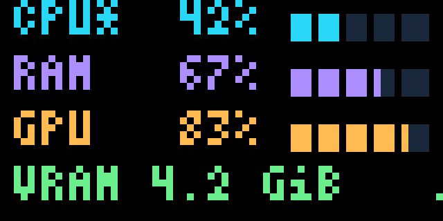

# PC stats hub

Run the Python launcher to display CPU, RAM and GPU usage, plus used VRAM.
It uploads the dashboard through Canvas, selects it once, then updates every two
seconds. The firmware does not need to know about PC metrics or this layout.



This LED matrix UI separates adjacent elements by brightness. Text sits on black;
each row's label, percentage and active bar share a bright colour. Empty meter
tracks glow dimly, so they are distinct from both the active segments and the
unlit area around them. There are no filled panels behind text. The four rows
are cyan CPU, violet RAM, amber GPU and green VRAM. The header is removed to
make room for VRAM below GPU usage. Dim fills are useful for clear contrast;
adjacent bright elements that need to be distinguished should be avoided.

## Start it

From the repository root, install the helper dependencies once:

```sh
python3 -m venv .venv
.venv/bin/pip install -r tools/requirements.txt
```

Connect the **board's own native USB data port** to the PC, then run:

```sh
.venv/bin/python tools/run.py dashboard
```

The launcher detects the Displaitor USB identity, uploads the scene and switches
to Canvas automatically. No button press is needed. The RP debug probe's USB
connection/UART is a separate device and cannot carry these uploads. The launcher
never automatically opens that port. With no native board connection, it prints
a waiting message and retries every two seconds. Serial access uses the host's
existing permissions; it does not change system configuration.

Current firmware is needed for the explicit `show` command. An older Canvas build
rejects that command; the launcher reports that a firmware update is required.

### Windows

Install Python 3.12 or newer, then run these commands from the project folder
in PowerShell (no virtual-environment activation is needed):

```powershell
py -3 -m venv .venv
.\.venv\Scripts\python.exe -m pip install -r tools\requirements.txt
.\tools\pc_hub.cmd
```

The launcher uses the local venv when present, otherwise the Windows `py -3`
launcher. You can also run `.\.venv\Scripts\python.exe tools\pc_hub.py` directly.
Native USB appears as a COM port. Auto-detection uses the board's USB identifiers;
when Windows omits its product/serial strings, a unique matching generic USB
serial port is accepted. Multiple matches require an explicit choice:

```powershell
.\tools\pc_hub.cmd --port COM7
.\tools\pc_hub.cmd --gpu windows:0
.\tools\pc_hub.cmd --gpu nvidia:0
```

CPU/RAM use psutil on Windows too. NVIDIA uses `nvidia-smi`, searched in PATH
and common driver locations. Otherwise `auto` uses Windows GPU performance
counters through PowerShell, covering driver-supported AMD/Intel/NVIDIA adapters.
`--gpu windows:N` explicitly selects this backend even when NVIDIA tools exist.
This index is the sorted counter adapter ID, not a promise to match Task Manager's
GPU numbering. The selected adapter stays fixed until the script restarts.
Missing/denied/unsupported counters show unknown readings while CPU/RAM continue.
No execution-policy override, administrator prompt or extra GPU Python package
is used. GPU subprocesses run without opening console windows.

## Read the display

- CPU: overall utilization across the PC, measured between samples.
- RAM: physical memory usage percentage, from the OS via psutil.
- GPU: selected GPU utilization, or `--%` with a dotted meter when unavailable.
- VRAM: used dedicated/reserved graphics memory in green, with explicit MiB/GiB
  units (for example `512 MiB` or `4.2 GiB`). `--` means unavailable. CPU-shared
  GPU memory is excluded; no total or capacity bar is inferred.
- At 85% a usage row's label, percentage and active bar turn yellow; at 95% they turn red. All text backgrounds remain
  transparent. Unavailable readings and their labels turn white.
- A small green dot at the bottom right switches on/off as samples arrive.
  There is no header or clock; all four readings have their own row.

The layout uses the eight named text slots in `tools/displaitor_tools/resources/layouts/pc_hub.json`.
Percentages are text updates; meters are a generated 64×32 RGB565 background.
Numeric boxes align right in fixed monospace cells: percentages reserve three
digits plus `%`, and VRAM has ten cells with its unit anchored at the right.
Labels, meter positions and units stay fixed when readings gain or lose digits.
Each sample sends one 4,096-byte background plus changed text/styles. Two-second
sampling therefore requests roughly 2 KiB/s of background data, plus framing and
small commands. This is a requested rate, not measured USB throughput. Transfers
wait for acknowledgements, with no queued frames or catch-up bursts.

Press B to browse away while the script keeps the retained scene current. It
does not select Canvas again on every update. A new connection/reconnection
uploads and selects the hub again. Ctrl+C stops the sender; the display retains
its last sample. A frozen dot means the displayed
values are a snapshot, not evidence that the PC is still connected. The firmware
does not independently expire the scene or detect a crashed host process.

## Options and GPU support

```sh
# Less frequent updates.
.venv/bin/python tools/run.py dashboard --interval 5

# Explicit device if multiple boards are connected; Linux by-id names are stable.
.venv/bin/python tools/run.py dashboard --port /dev/serial/by-id/YOUR-DISPLAITOR-DEVICE

# One snapshot, then exit. A connection error fails immediately in finite modes.
.venv/bin/python tools/run.py dashboard --once

# Choose an AMD Linux DRM card, NVIDIA GPU index, or disable GPU polling.
.venv/bin/python tools/run.py dashboard --gpu card1
.venv/bin/python tools/run.py dashboard --gpu nvidia:0
.venv/bin/python tools/run.py dashboard --gpu windows:0 # Windows only
.venv/bin/python tools/run.py dashboard --gpu none
```

On Linux, `auto` first looks for AMD DRM load/VRAM counters, then tries NVIDIA
GPU 0. Multiple AMD cards are ordered by card name; select `cardN` explicitly.
AMD uses `gpu_busy_percent` and `mem_info_vram_used`; NVIDIA requests utilization
and used memory in one query. NVIDIA calls have a one-second timeout. Windows
CIM queries have a three-second timeout, so slow counters can lower the update
rate. Missing/invalid/unsupported readings remain unknown; no zero is invented.

The Windows backend groups engine usage by adapter and engine, sums its process
shares, and reports the busiest engine. Memory comes from the same adapter's
dedicated-memory counter, not summed process allocations. This follows
[Microsoft's GPU reporting model](https://devblogs.microsoft.com/directx/gpus-in-the-task-manager/)
and uses [WMI performance classes](https://learn.microsoft.com/en-us/windows/win32/wmisdk/accessing-wmi-preinstalled-performance-classes).
NVIDIA fields follow its [query documentation](https://nvidia.custhelp.com/app/answers/detail/a_id/3751/kw/command).

Linux CPU/RAM and this PC's AMD load/VRAM counters were exercised locally.
Windows/NVIDIA behavior has fixture tests. A Windows CI job builds the headless
simulator and runs the helper suite; it has not run remotely yet. Native Windows
execution, real Windows GPU counters, and physical USB uploads still need their
own checks. The script does not install drivers or GPU utilities.

Recovery tests also stop a real simulator, rediscover a fresh simulator endpoint
and compare the rendered scene before/after reconnection. Readings remain fixed
across the restart, so restoring the text and warning styles cannot rely on
their values changing. Metric sampling and port discovery are fixtures; transport,
disconnect detection, acknowledgements, scene upload and rendering are real.

## Simulator

```sh
cargo run -p simulaitor -- --canvas-listen 127.0.0.1:7777
# In another terminal, live stats from the local PC:
.venv/bin/python tools/run.py dashboard --port tcp://127.0.0.1:7777
# Or synthetic values for a repeatable preview (CPU* marks demo mode):
.venv/bin/python tools/run.py dashboard --port tcp://127.0.0.1:7777 --demo
```

`--demo` marks the first row `CPU*` to distinguish synthetic data.
`--once` sends one sample; `--count N` sends a finite number. `--interval` is at
least 0.2 seconds, with a default of two seconds. The committed image is an actual
Rust simulator frame fed by the Python launcher and enlarged without smoothing.
See [validation](VALIDATION.md) for tests and the boundary between simulator,
SWD render checks and a real native-USB session.

The updated firmware has been flashed and readback-verified. An earlier static snapshot
of real PC metrics was also rendered on-chip through SWD. This is a retained
snapshot, not a continuous host connection.
Only the probe was enumerated during that check. The later
[native USB hardware tests](HARDWARE-CANVAS-USB.md) passed real and labelled-demo
PC metrics updates, with actual framebuffer output matching the Rust renderer.
