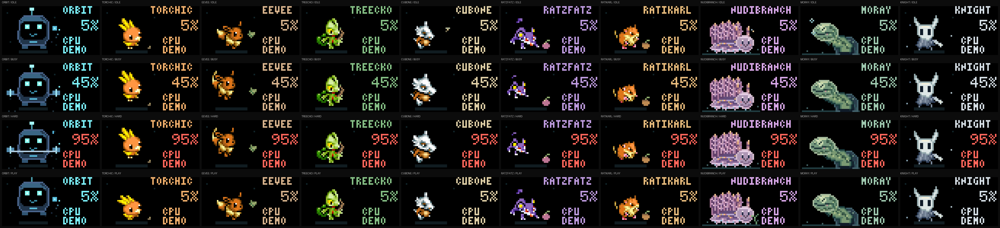
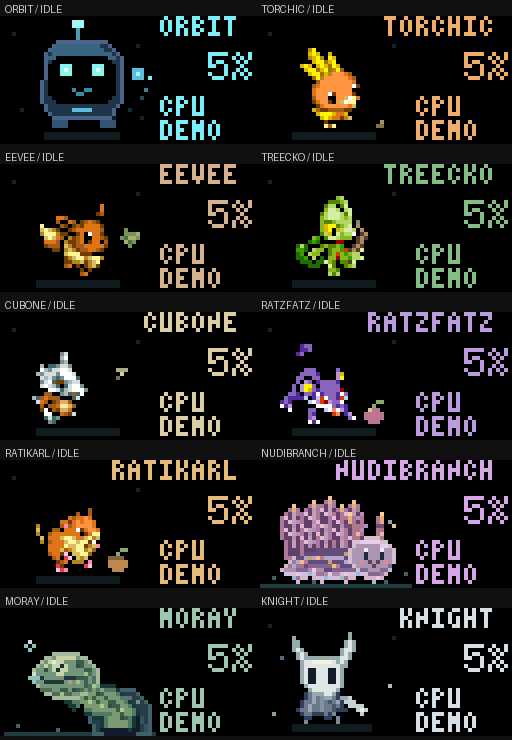
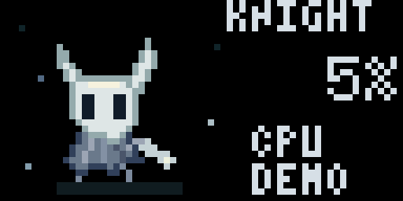
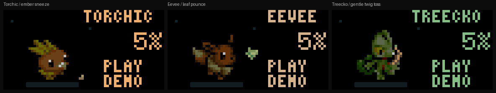
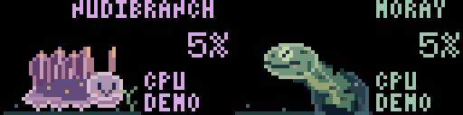
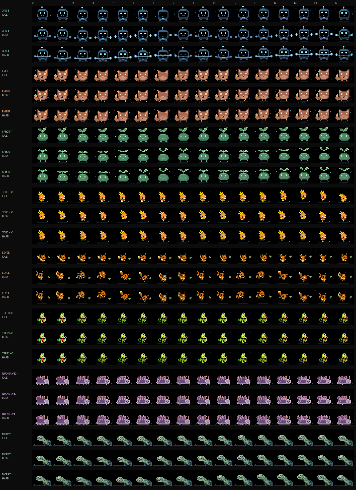
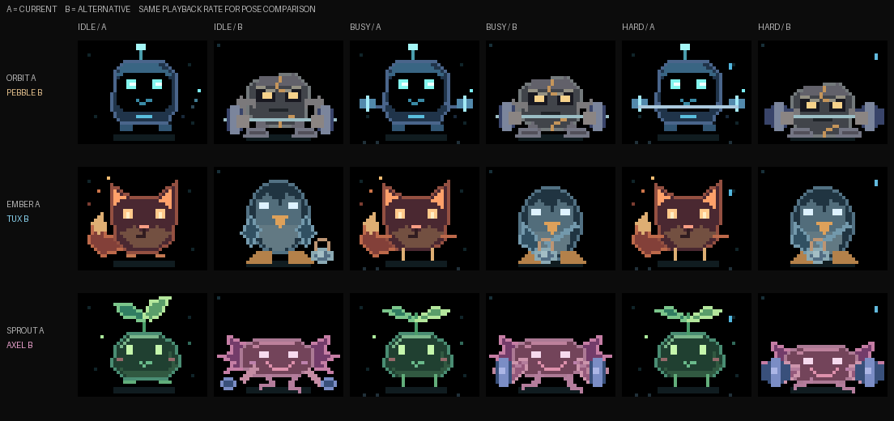

# Pixel Companion

An idle character that exercises harder as PC usage rises. Run the Python sender
to open Canvas and stream the character; it uses real CPU/GPU readings by default.
Choose Orbit, Torchic, Eevee (Evoli), Treecko (Geckarbor), Cubone, Ratzfatz,
Ratikarl, Nudibranch, Moray or the Knight from Hollow Knight. Ember and Sprout are temporarily removed from
the live CLI and rotation; their artwork remains archived for offline studies.
It is a host-driven Canvas scene, so it appears
while this script runs and does not automatically replace another app on idle.

Start the sender from the updated checkout with `python tools/run.py companion`,
or use `displaitor companion` from the environment where the current package is
installed. Flashing firmware does not update an already running Python sender.
The current sender prints the full Left/Right pet roster and button controls at
startup. If an older checkout only shows Orbit without controls, stop that sender
and launch the updated one. Only one sender should own the USB port.



| Design | Idle | Working | Hard work |
| --- | --- | --- | --- |
| **Orbit** | [Floating robot](ui/companions/activity/orbit-idle.gif) | [Lifting dumbbells](ui/companions/activity/orbit-busy.gif) | [Faster barbell lifts](ui/companions/activity/orbit-hard.gif) |

Every design uses whole-pixel shapes, a black background and a small palette.
Bodies, shadows and accents keep their authored colours; output gamma handles
the LED panel response.
Labels sit on black. Text is rendered by the actual Rust Canvas implementation.
Ember and Sprout no longer use the earlier manually darkened bodies. Their
body midtones were then tuned on the panel at gamma 2.8; the user confirmed both
look good. Eyes, cheeks, ear/tail tips and all animation geometry are preserved. The same palette applies while exercising
and hopping.

## Idle motion

Idle loops have 64 ticks at six ticks per second, giving each pet about eleven
seconds of gentle ambient motion. Breathing, blinking and drifting props keep
the pauses alive; workload animations still run at eight or twelve pose ticks per second.
The sender retains its existing bounded upload rate. Idle gestures are silent
and never trigger A-button cries or replace live readings with sample values.
Floors, scenery and HUD positions stay fixed; USB output gamma remains 2.8.
Idle uses idle poses, with source-padding offsets removed so pets keep their
feet down. Food approaches, pounces, eating, hops and other tricks are reserved
for A; they do not run automatically while idle.

| Pet | Idle sequence |
| --- | --- |
| Orbit | Floats gently and tracks a small drifting hologram with its eyes. |
| Torchic | Subtle breathing and crest motion, with feet anchored beside its seed. |
| Eevee | Watches a leaf on a wider drifting path and occasionally glances at the viewer. |
| Treecko | Makes tiny wrist adjustments while holding its twig; its feet stay planted. |
| Cubone | Watches a circling firefly and occasionally turns towards the viewer. |
| Ratzfatz | Small idle ear/body movements beside a berry with a gently swaying leaf. |
| Ratikarl | Quiet idle pose changes beside its acorn, with no approach or eating. |
| Nudibranch | Waves its plumes and skirt while its feelers and eyes follow plankton. |
| Moray | Breathes, peers out and sends little bubbles drifting upward. |
| Knight | Cloak folds sway, eyes glance and blink, and pale motes drift past its nail. |



## Hollow Knight

Choose `--design knight`, or cycle past Moray with Right. The horned mask,
cloak, nail, blinking eyes and motes are original, native-resolution Python art.
On A, the Knight crouches, jumps, then plunges down in a
[Descending Dark-inspired spell](https://hollowknight.wiki/w/Descending_Dark).
Two spreading shadow shockwaves and small particles mark the landing before
it settles back into its quiet idle stance. The cast lasts 2.4 seconds,
is silent, and clears when complete or when switching
pets. Idle stays calm between explicit casts. The floor and HUD stay fixed;
B still returns to the menu.

```sh
python tools/run.py companion --design knight
```



## Mystery Dungeon pets

The six Pokémon pets use native Mystery Dungeon poses, inspired by Red Rescue
Team, with original source colours and small bright details. Their old 43% body / 74%
highlight attenuation is removed; the SDK applies output gamma once. They are part of the live
sender's normal Left/Right rotation, after Orbit.



| Pet | Idle | Working / hard work | A button |
| --- | --- | --- | --- |
| **Torchic** | [Crest bob and a curious look at a seed](ui/companions/rescue-pets/torchic-idle.gif) | [Little steps](ui/companions/rescue-pets/torchic-busy.gif), [eager hops and tiny embers](ui/companions/rescue-pets/torchic-hard.gif) | [Crouches, sneezes a few embers, hops back and looks pleased](ui/companions/rescue-pets/torchic-play.gif) |
| **Eevee / Evoli** | [Ear twitch and a glance at you](ui/companions/rescue-pets/eevee-idle.gif) | [Bounds after a drifting leaf](ui/companions/rescue-pets/eevee-busy.gif), [with more spring under load](ui/companions/rescue-pets/eevee-hard.gif) | [Crouches, pounces to touch the leaf, then returns](ui/companions/rescue-pets/eevee-play.gif) |
| **Treecko / Geckarbor** | [Holds a little forked twig with small gecko fingers](ui/companions/rescue-pets/treecko-idle.gif) | [Gently rolls its wrist](ui/companions/rescue-pets/treecko-busy.gif), [with a wider motion under load](ui/companions/rescue-pets/treecko-hard.gif) | [Bends its arm, tosses the twig through one turn, opens its hand and catches it](ui/companions/rescue-pets/treecko-play.gif) |
| **Cubone** | [Curious head bob](ui/companions/activity/cubone-idle.gif) | [Steps and eager hops](ui/companions/activity/cubone-hard.gif) | [Hops with its bone and kicks a little dust](ui/companions/activity/cubone-play.gif) |
| **Ratzfatz / Rattata** | [Ears and tail twitch](ui/companions/activity/ratzfatz-idle.gif) | [Scampers eagerly](ui/companions/activity/ratzfatz-hard.gif) | [Approaches a berry, nibbles and bounces home](ui/companions/activity/ratzfatz-play.gif) |
| **Ratikarl / Raticate** | [Contented breathing](ui/companions/activity/ratikarl-idle.gif) | [Little determined steps](ui/companions/activity/ratikarl-hard.gif) | [Munches an acorn, drops crumbs and settles](ui/companions/activity/ratikarl-play.gif) |

[All three pets in idle/work/hard/play states](ui/companions/rescue-pets/workload-designs.png).
The new tricks take 1.8 seconds, independently of CPU/GPU readings. The floor
and text stay fixed; `%` stays anchored between `1%` and `100%`. The full Torchic
and Treecko names fit in a slightly wider header with a four-pixel right gutter,
without moving the numeric or status slots. Treecko's feet stay planted as its
elbow, wrist and fingers move. The original pets keep their short A-button hop.

Select a new pet directly with `--design torchic`, `--design eevee` or
`--design treecko`. The bundled [sprite inputs and attribution](../tools/displaitor_tools/resources/art/rescue-pets/README.md)
are used only by the host app, with no runtime downloads or firmware changes.
New-pet checks cover real Python-to-Rust Canvas rendering and rasterized prop
contact/catch events. The Torchic live sender also connected successfully over
native USB on 2026-10-28. Panel feedback informed the name padding and Treecko
hand/motion refinements; those latest refinements are simulator-verified and
running locally, with a physical appearance recheck pending.

The additional pets use the same pinned sprite source and original colours:
Cubone hops with its bone, Ratzfatz investigates and nibbles a berry, and Ratikarl
munches an acorn. All have idle, working, high-load and A-button animations,
with fixed floors and reserved header space. Start with `--design cubone`,
`--design ratzfatz` or `--design ratikarl`. Their actions are silent; the existing
synthesized cries remain available for Torchic, Eevee and Treecko.

## Sea pets (Python only)

Two original pets join the normal Left/Right rotation after Treecko. Both have
idle, working and hard-work poses; unavailable readings use a calm pose rather
than suggesting load. Up/Down still changes CPU/RAM/GPU/VRAM pages, with fixed
numeric fields and a full-width padded name header for NUDIBRANCH.

| Pet | Idle / workload | A button |
| --- | --- | --- |
| **Nudibranch** | Lavender mantle, orange sensory horns, rippling skirt and feathery cerata; stronger gill movement under load | Reaches for sea lettuce, nibbles and shows a contented heart |
| **Moray** | Spotted green eel breathing in a fixed cave; stretches further out and flexes more under load | Blows a growing bubble which floats away as a little heart |

Actions take 2.4 seconds and are silent. USB apps apply
[automatic output gamma](COLOR-OUTPUT.md) to both sprites and retained text. The seabed, cave and text stay put.
Standalone sea pets use finer pixel detail: five feathered plumes, segmented
sensory horns and an iridescent skirt for Nudibranch; a curved, shaded neck,
patterned skin, dorsal fin and highlighted eye for Moray. These are authored at
the panel's native resolution, with gamma 2.8 still applied once by the SDK.
No extra firmware, downloaded art or new dependencies are needed.

```sh
python tools/run.py companion --design nudibranch --port COM6
python tools/run.py companion --design moray --port COM6
# A text-free scene with both animals together:
python tools/cozy.py --scene reef --port COM6
# Export only the sea-pet activity/action previews (simulator required):
python tools/run.py preview activity --design nudibranch --design moray --output-dir target/sea-pets
```



[Idle / work / hard / play gallery](ui/companions/marine/workload-designs.png).
These previews use labelled sample readings; normal operation reads live stats.
All artwork is local, typed Python 3.12+. A native USB smoke test on
2026-10-28 exercised both pets at idle/work/hard loads and their scripted actions,
followed by the three new fullscreen themes: 413 background frames were
acknowledged with no protocol errors. Existing firmware was used without
flashing or debugger pauses. Physical appearance and button presses still await
user confirmation.

## Archived combined sprite sheet

[Native sprite sheet](ui/companions/activity/sprite-sheet.png) contains all 384
character frames at their original pixel resolution. Each cell is 40×32 pixels,
cropped to the character region; the separate 24-column Canvas HUD is omitted.
There are 16 columns (frames 0–15) and 18 rows: idle/work/hard for each pet in
selection order: Orbit, Ember, Sprout, Torchic, Eevee, Treecko. The full sheet is
640×576 pixels. A-button tricks are shown in the separate GIFs above.



Regenerate both native and labelled sheets without a simulator or device:

```sh
.venv/bin/python tools/run.py preview designs --sprite-sheet-dir docs/ui/companions/activity
```

## New casts and Pokémon studies

The latest [play iteration and Monster Hunter-inspired creatures](COMPANION-PLAY.md)
give Cubone bowling pins, Treecko juggling berries and Torchic a toy ball. A
separate creature-only set features a rock-gobbler, winged night-cat and thunder-pup
playing with a pebble, feather and glowbugs. These use 24-frame play sequences.

[Fresh creatures and Pokémon](COMPANION-COLLECTIONS.md) provide two more complete
sets for choosing: Clack the crab, Lumen the jellyfish and Cinder the dragon;
plus Cubone, Treecko and Torchic. Their actions include claw presses, tentacle
pulses, wingbeats, fire, bone swings, leaps and hops. Each set has an animated
gallery and a 144-frame sprite sheet. These remain separate selection previews.

## Alternative characters: set B

These are an alternative set for choosing, separate from the current sender.
The comparison pairs are suggestions; characters can be mixed freely.

| Current A | Alternative B | Alternative exercise |
| --- | --- | --- |
| Orbit robot | **Pebble**, a stone golem | Waist-to-overhead barbell presses, heavier plates and a deeper squat under load. |
| Ember fox | **Tux**, a penguin | Kettlebell swings with broad flippers; the bell moves up and out as effort increases. |
| Sprout plant | **Axel**, an axolotl | Large overhead dumbbell presses and deep squats, with visible gills and a wide smile. |



This comparison plays both sets at the same rate to compare poses. The individual
alternative GIFs use 3/8/12 animation steps per second for idle/work/hard. All art
uses the existing 40×32 character region, RGB565 colours and black behind the HUD.
Axel's weights travel 17 pixels vertically and its hard-work squat moves its body
six pixels, giving a much clearer silhouette change than Sprout's small leaves.

- [Static comparison, frame 8](ui/companions/alternatives/comparison.png)
- [Labelled alternative sprite sheet: all 144 frames](ui/companions/alternatives/sprite-sheet-labelled.png)
- [Native alternative sheet: 640×288, 40×32 cells](ui/companions/alternatives/sprite-sheet.png)
- Individual hard-work loops: [Pebble](ui/companions/alternatives/pebble-hard.gif),
  [Tux](ui/companions/alternatives/tux-hard.gif), [Axel](ui/companions/alternatives/axel-hard.gif).

Regenerate this set and its A/B comparisons offline:

```sh
.venv/bin/python tools/run.py preview alternatives
```

No alternative is selected in the live sender yet. Its original characters and
the firmware remain unchanged while Dave picks the preferred set.

## Run it

Install the existing [Canvas dependencies](CANVAS.md). With the board's **native
USB data connection** available, run from the repository root:

```sh
.venv/bin/python tools/run.py companion --design torchic
```

On Windows:

```bat
tools\run.cmd companion --design torchic
```

The launcher uses the repository's Windows virtual environment if present, or
`py -3` otherwise. It needs the same Python dependencies. Native-board discovery
excludes the probe UART. The original Orbit, Ember and Sprout idle/work/hard states passed
[Linux native USB uploads and hardware framebuffer comparisons](HARDWARE-CANVAS-USB.md).
Windows execution remains unverified; a debug probe alone does not provide a
Canvas serial connection. Earlier SWD-only checks are retained in
[connected rendering evidence](VALIDATION.md#companion-sprite-sheet-and-connected-rendering-2026-10-21).

To try it locally, first start the simulator in another terminal:

```sh
cargo run -p simulaitor -- --canvas-listen 127.0.0.1:7777
.venv/bin/python tools/run.py companion --port tcp://127.0.0.1:7777 --design cubone
```

Canvas is selected once when connected, after preparing the scene. B returns to
the menu while the sender continues updating the retained scene. Reconnection
reinstalls the whole scene and opens Canvas again. Ctrl+C stops and retains the
last frame. A stopped sender leaves a still image, not a firmware screensaver.
Running only `pc_hub.py` continues to show its dashboard; run `pixel_companion.py`
instead to show the companion. Use one sender per device.

## How usage drives the character

By default the larger available CPU or GPU utilization drives its effort.
`--load cpu` or `--load gpu` chooses one explicitly; `--gpu` supports the same
backends as the PC hub. This activity source is independent of the selected HUD page.
High RAM occupancy alone is not work and does not make the character exercise.

| Activity | Enters at | Animation |
| --- | --- | --- |
| IDLE | Below 20% on initial reading | Gentle bob and blink; 3 animation steps/s |
| WORK | At least 20% | Exercise poses; 8 animation steps/s |
| HARD | At least 65% | Faster exercise, larger bob and sweat; 12 animation steps/s |

WORK returns to idle below 15%; HARD leaves below 55%. These small gaps prevent
jitter around the thresholds. The selected value and its metric label share the same colour,
with amber at 85% and red at 95%. The percentage reserves four medium-font cells
and aligns right, keeping `%` anchored from `1%` to `100%`. Missing counters show `--%` (VRAM: `--`); stale activity shows `WAIT`, rather than
pretending the PC is idle. Auto can use CPU when GPU is unavailable; explicit
GPU mode waits for GPU data.

Metrics are sampled once per second (`--interval`, at least 0.2s). A single
background worker owns the CPU/RAM/GPU/VRAM sampler and publishes only its latest sample;
slow OS/GPU queries do not block animation. Samples expire after the greater of
six seconds and three sampling intervals. Animation uploads default to 8fps
(`--fps`, at most 20); acknowledged transfer speed can lower the actual rate.
No frame queue or catch-up burst accumulates. `--frames N` sends a finite run.

## Stats and sound controls

Up/Down cycle CPU → RAM → GPU → VRAM → ALL, wrapping in either direction.
`--view ram` (or `cpu`, `gpu`, `vram`, `all`) selects the initial page. Switching
pages preserves the pet, its animation phase and any running trick. Left/Right
change the pet while preserving the selected page. Neither action calls Show,
so a late Back keeps the local menu in control.

CPU/RAM/GPU pages show the actual selected percentage, even when a different
counter drives the pet's effort. VRAM shows **used dedicated memory**, using
compact binary M/G/T units (for example `512M` or `3.2G`), because the existing
sampler provides used bytes rather than capacity. Missing readings remain `--`.
ALL reserves four six-glyph rows: `C` CPU, `R` RAM, `G` GPU, `V` used VRAM.
Labels and `%` stay anchored from 0 through 100; numeric cells are right-aligned.
No additional sensor polling is needed for page changes.

A plays an original synthesized handheld-style cry alongside the Torchic,
Eevee or Treecko trick. Each is a short, one-shot QOA asset using the existing
firmware audio path; no synthesis or allocation runs on the board. These are
GBA-inspired approximations, not recordings of the original game cries. Back
stops the cry and returns to the local menu. Select mute drops an active cry;
unmuting does not replay it. `--no-sound` keeps tricks silent. Older firmware
continues displaying the stats and animations, with a one-time update message
if a cry is requested. [Synthesis sources and regeneration](../assets/audio/CRIES.md).

## Preview and demo modes

For a visibly labelled synthetic idle → work → hard cycle, four seconds per state:

```sh
.venv/bin/python tools/run.py companion --port tcp://127.0.0.1:7777 --demo
```

`--demo-load 95` holds a fixed labelled demo reading (RAM 64%, used VRAM 3.2 GiB).
DEMO replaces the activity footer, or the name header in ALL, so synthetic values
cannot be mistaken for actual telemetry. Live mode
is the default. `tools/run.py companion --port ...` runs the live application,
including actual metric readings and button controls. Offline preview exports
retain explicitly labelled fixture values.

With updated firmware, Left/Right switch through all ten pets and A triggers
the selected pet's hop or trick. Up/Down switch stats. Back
still returns to the local menu and Select retains mute. Use `--no-buttons` to
disable pet controls; see [the host button interface](CANVAS-BUTTONS.md) to add
your own scene/action handling through the same connection.

To regenerate the activity sheet, all 40 native-size activity/action GIFs and
the enlarged animated idle gallery locally:

```sh
cargo build -p simulaitor --no-default-features
python tools/run.py preview activity --output-dir target/activity-previews
```

The exporter uploads each scene over simulator TCP, captures its real-rendered
HUD, and combines it with the exact RGB565 sprite frames. GIFs retain the 64×32
grid; the sheet uses nearest-neighbour enlargement. This does not contact hardware.


To export a five-page gallery, animated page cycle, pet actions and a video with
sound (ffmpeg required), first generate decoded QOA WAVs as described in
[CRIES.md](../assets/audio/CRIES.md), then run:

```sh
python tools/run.py preview stats --audio-dir target/cry-auditions --output-dir docs/ui/companions/stats-cries
```

These exports capture text from the real Rust renderer and composite the exact
uploaded RGB565 sprite frames. All shown values are explicitly labelled samples;
there is no hardware connection. The MP4 plays the three cries separately; GIFs
are silent. [Page gallery](ui/companions/stats-cries/stats-gallery.png),
[page cycle](ui/companions/stats-cries/stats-cycle.gif),
[pet actions](ui/companions/stats-cries/pet-actions.gif),
[video with sound](ui/companions/stats-cries/pet-cries.mp4).


Offline verification for the stats/cries update (2026-10-28): 114 native Rust
and 85 Python tests passed, including real Python-to-Rust rendering of all five
pages, input/lost-event handling, fixed alignment, missing/stale readings,
transaction abort/Back priority, mute/restart/EOF and old-firmware fallback.
Workspace strict Clippy and headless/SDL-dummy simulator smoke checks passed.
All three assets reproduced byte-for-byte from the pinned encoder and source.
The four RAM/XIP release variants passed ELF checks, including Cortex-M0+ boot
emulation for RAM builds and five negative tests for the validation guards.
The normal RAM build has 90,376 bytes of SRAM headroom after its reserved core-0
stack. No board was connected, flashed or tested for this update; speaker quality
and physical controls remain to be checked on hardware.
