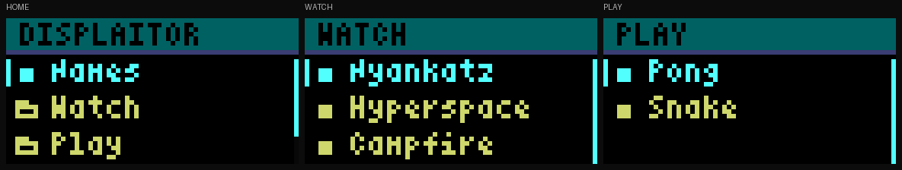
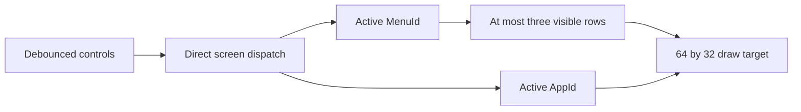

# UI architecture

The UI is a direct application runtime plus an indexed static menu catalog.
A parent menu never wraps, updates, or renders its active child. Menu depth is
navigation data and does not enter the frame loop.

For LED matrix UI work, use relative brightness to distinguish adjacent elements:
bright beside dim and dim beside off work well; bright beside bright can wash
out the distinction. Dim fills are useful when the neighbouring content remains
clear. The PC hub uses bright text on black and bright meter segments on dim
tracks. Each row's label, percentage and active bar share their colour.

The menu has a dimmer coloured title strip with pure black lettering. All three
content rows stay black, including the selected row; cyan text and a narrow
left marker identify selection. Folder/action markers, truncated labels and
an edge position indicator remain. Its active scrollbar marker is cyan; the
inactive track is the lowest neutral grey representable in RGB565, `(1,2,1)`
(expanded RGB888 `#080808`), separate from the title separator colour. Home contains Names, Watch, Play and Canvas. Watch contains Nyankatz,
Hyperspace and all ten autonomous fullscreen scenes: Fireplace, Farm dusk,
Snow walk, Blossoms, Valley camp, Tidepool, Palico, Rathalos, Zinogre and Poogie. Play contains Pong and Snake. A activates, B returns,
and up/down move once per press. The connected GPIOs and Select/mute behavior
are retained. Physical left/right are GPIO18/GPIO23; the legacy labels were
reversed and are corrected in the board adapter for every application.



## Navigation and dispatch

`navigation.rs` defines `MenuId`, `Menu`, `Entry`, `Action`, and `Navigation<N>`.
Menu IDs index a read-only array; actions contain either another menu ID or a
concrete `AppId`. Each menu stores its direct parent. Runtime state is one active
ID and one cursor per menu, with no stack, boxed parent, trait-object chain,
recursive event forwarding, or per-frame graph search.

`Engine<N>` owns that navigation state and the active screen. `Screen` is one of
`Splash`, `Menu(MenuId)`, or `App(AppId)`. It dispatches directly to the active
application; applications do not know or visit their menu ancestors.



An application launch leaves the navigation context in place. Back therefore
returns to the actual originating menu and its retained cursor, even if the same
application appears in several different menus. Back inside a menu reads its
single parent link. Returning to root does not clear other menus' cursors.

The graph is checked once by `Navigation::new`: empty menus, missing/out-of-range
references, duplicate child menus, inconsistent parents, and cycles are rejected.
The catalog is a tree of menu nodes; application targets may be reused. Shared
submenu nodes with multiple parents are rejected because a static parent would
be ambiguous. There is no arbitrary maximum navigation depth: the number of
statically allocated menus is the limit.

| Operation | Cost after construction |
| --- | --- |
| Idle menu update | Fixed input/dispatch work; no redraw |
| Move selection | Direct active-menu/cursor access |
| Enter child | Direct selected entry and child ID |
| Back | One direct parent link |
| Launch/update/render app | Direct app dispatch, independent of menu ancestors |
| Render menu | At most three rows, 14 title glyphs, 11 glyphs per row |
| Runtime navigation storage | One cursor per menu, plus fixed IDs/references |

Construction is O(entries + menus²) in the worst case because it validates parent
chains once. This is outside frame processing. Catalog records and labels reside
in static storage. Increasing catalog size increases its storage and startup
validation work, not recurring update/render work.

`menu_view.rs` receives a resolved, bounded `MenuView`, not a menu tree. It cannot
walk parents. It stops label scans after the visible prefix before invoking font
rendering; clipping alone would still waste work processing offscreen text.
The names catalog is indexed and its Unicode character widths computed at compile
time. Names updates/rendering no longer scan all preceding lines or recount the
catalog. Images still decode their current fixed-size QOI frame when redrawn;
that work is independent of navigation depth.

## Extending the catalog

For built-in navigation, add records/entries in `content.rs`, give each child its
parent ID, and adjust the array's length. The default `Engine` size is inferred
from that array. No ancestor dispatch or renderer changes are needed.

A separate catalog can instantiate the same runtime:

```rust
use displaitor::{AppId, Engine};
use displaitor::navigation::{Action, Entry, Menu, MenuId};

static MENUS: [Menu<'static>; 2] = [
    Menu::new("HOME", None, &[
        Entry::new("Games", Action::Menu(MenuId::new(1))),
    ]),
    Menu::new("GAMES", Some(MenuId::new(0)), &[
        Entry::new("Pong", Action::App(AppId::Pong)),
        Entry::new("Snake", Action::App(AppId::Snake)),
    ]),
];
let engine = Engine::<2>::with_menus(&MENUS, MenuId::new(0))
    .expect("valid static catalog");
```

Concrete apps use an exhaustive enum rather than a plugin framework. Add an
app to the `application_ids!` declaration in `engine.rs`, its owned state/update/
render handling and a catalog entry. That single declaration generates `AppId`,
`AppId::ALL` and `AppId::COUNT`. Profiling/simulator storage uses the generated
count, and smoke coverage iterates the generated list; extending the enum cannot
silently leave those arrays undersized or omit the new app from coverage. Add
smoke inputs that visit the new application too. Compiler exhaustiveness checks
help locate required runtime changes. All entries
are active; disabled entries and empty placeholders are not part of the model.

The Cozy apps use deduplicated QOI atlases in Flash, generated from the typed
Python scene renderers. A constant-validated timeline borrows one frame directly
for the existing QOI decoder, with no extra framebuffer or allocation. Clip
metadata supplies the shared advancement and scheduling period (100 ms).
Repeated frames suppress redraws; paused scenes without a reaction have no autonomous deadline.
A triggers a 3.2-second sparse overlay without resetting the ambient clock;
Up/Down pauses/resumes, Left/Right switches scenes, and local B keeps its normal priority
and returns to the originating menu. See [cozy apps and assets](COZY.md).

Canvas adds retained RGB565 background storage and eight indexed text slots to
the same direct runtime. Text has bounded UTF-8 storage, three bitmap font sizes,
per-slot clipping, foreground colour and transparent/opaque backgrounds. A redraw
composites the background and slots in order, restoring pixels under replaced
text. Idle Canvas updates do not request redraws. Incoming content never changes
the active screen, and leaving Canvas preserves its scene and navigation context.
Until the first successful scene mutation, Canvas renders a fixed four-line setup
hint on black: connect USB to a PC and run `tools/pc_hub.py`. Info, Show and invalid
requests preserve the hint; a valid explicitly black scene hides it. This adds one
retained flag and fixed rendering work, independent of menu depth.
The explicit serial Show command queues a single activation for `Engine::update`;
that update emits the same redraw/audio effects as a local launch. Local B takes
priority, and repeated Show requests while already in Canvas are harmless.
Transport adapters queue intent instead of switching apps in the middle of drawing.
The [PC hub](PC-HUB.md) is a host script and layout over this interface; it adds
no application ID, menu nesting or metric-specific firmware state. Its header-free
layout uses four label/value pairs: CPU, RAM, GPU and green VRAM below GPU.
The three usage meters retain dim empty tracks; VRAM displays a used byte count
with binary units rather than implying a capacity percentage. This still uses
only eight retained text slots.
The [Pixel Companion](PIXEL-COMPANION.md) also runs entirely on the host over
Canvas: CPU/GPU sampling, threshold hysteresis and exercise animation add no
firmware state or per-frame navigation work. Its background and four named text
slots reuse the same bounded renderer. One background sampling thread publishes
the latest reading, with expiry; the animation sender owns all protocol traffic.

USB and the simulator's loopback transport share a bounded COBS/CRC32 endpoint.
Its complete packet buffer validates individual uploads. Optional Begin/Commit/
Abort transactions retain a separate staged scene, keeping all visible layers
unchanged until a logical update commits. Invalid commands poison staging;
disconnect aborts it. The host helpers transact dashboard/companion installation
and every update, including deferred Show. Transport adapters own
I/O; the allocation-free application consumes validated commands. Serial service
and rendering never walk menu ancestors. Canvas itself is additionally checked
at depths 1/16/64/128. See [Canvas](CANVAS.md) for usage and the wire contract.

Firmware input sampling and presentation are separate from engine dispatch.
A timer IRQ retains timestamped debounced transitions while the foreground is
drawing; the runtime replays them in order. A pending display swap releases the
foreground to continue USB and application processing. See
[runtime architecture](RUNTIME-ARCHITECTURE.md) for ownership and timing limits.

## Evidence

Luna agents implemented navigation and presentation, wrote independent regression
tests, and reviewed the final integration. Tests traverse a 130-menu chain,
restore each ancestor's selection, launch a reused app from different menus, and
compare both menus and running apps at depths 1, 16, 64 and 128.

For identical two-row menus, the real `Engine::render` produces the same complete
frame, pixel count, draw-call count and hash at every depth:

| Active depth | Emitted pixels | Draw batches | Frame hash |
| ---: | ---: | ---: | --- |
| 1 | 3,822 | 25 | d5dfabfa |
| 16 | 3,822 | 25 | d5dfabfa |
| 64 | 3,822 | 25 | d5dfabfa |
| 128 | 3,822 | 25 | d5dfabfa |

These counts and hashes were refreshed on 2026-10-20 after the menu contrast
and title/scrollbar refinements. Work remains 3,822 pixels and 25 batches;
the six extra pixels and one batch over the original inverse-row design are
its narrow selection marker.

Independent source review confirms there are no parent-chain loops in the runtime
methods. Equal pixel counts alone would not rule out hidden navigation work;
the direct-access implementation and running-app tests are also checked.

The diagnostic host release benchmark measures idle updates, direction pairs,
actual child-menu enter/back pairs, and full renders with graph construction
excluded. It takes the median of three samples and makes no timing assertions.
Host timings vary substantially with concurrent machine load, so they are not an
RP2040 frame-time or audio-jitter measurement. Deterministic work comparisons
are the regression gate.

```sh
cargo test -p displaitor --test navigation_cost
cargo bench -p displaitor --bench navigation
cargo run -p displaitor --example menu_preview
./scripts/check.sh
```

The preview example writes actual unscaled PPM frames to `target/ui-preview`.
The committed contact sheet enlarges those pixels with nearest-neighbor scaling.
The complete workspace tests, strict host/ARM Clippy, headless/SDL smoke checks,
and release firmware linking pass. Subsequent SWD checks exercised navigation,
Canvas rendering, framebuffer swaps and scene retention on the RP2040; see
[connected-board evidence](VALIDATION.md#connected-board-checks). the user's photo
confirms the visible test-card layout and text backgrounds, and he subsequently
confirmed the corrected panel colours looked good. Subsequent uninterrupted
instrumented game captures measured about 50 redraws/s for Pong and 16.6 for
Snake; see [game timing evidence](VALIDATION.md#game-tests-and-on-board-timing).
Physical scan timing and input/audio latency still need their own checks.
