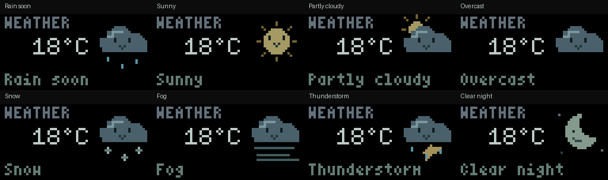

# Animated weather

The weather app keeps the muted grey/mint text on black and adds a small pixel
character above the bottom condition line. **That same condition string selects
the animation.** “Rain soon” shows a blinking cloud with falling drops. The text
stays still, and the artwork stays in the upper-right corner.
Temperature has six reserved medium-font cells, including the sign and unit.
Values such as `1°C`, `18°C`, `-18°C`, and `-100°C` keep `°C` anchored at the same
position; changing `18°C` to `-18°C` adds a sign without moving the other digits.
Values longer than six characters are rejected instead of clipping the unit.




Use the same Python environment as Canvas and Pixel Companion:

```sh
python tools/weather.py --status 'Rain soon' --temperature '18°C'
# Explicit target, including a local simulator:
python tools/weather.py --port tcp://127.0.0.1:7777 --status 'Snow' --temperature='-2°C'
```

`--port auto` selects the board's native USB data connection. Run only one host
app on that connection at a time. The app runs at eight animation updates per
second, with acknowledgement backpressure and no frame queue. `--fps` changes
the upload rate; animation speed follows elapsed time. Back still returns to
the local menu. The sender does not reopen Canvas on every frame.

The initial temperature and condition come from `tools/layouts/weather.json`;
CLI values override them. These are supplied/example values, **not a weather
service**. Merely uploading that JSON with `canvas.py layout` remains static;
run `weather.py` for animation.

| Bottom condition, for example | Animation |
| --- | --- |
| Rain soon, Light showers, Drizzle | Cloud with falling rain |
| Sunny, Clear | Smiling sun with gently moving rays |
| Partly cloudy | Sun peeking behind a cloud |
| Cloudy, Overcast | Floating, blinking cloud |
| Snow, Snow showers, Sleet | Cloud with drifting snowflakes |
| Fog, Mist | Cloud with moving mist lines |
| Thunderstorm, Storm | Rain cloud with a small steady lightning bolt |
| Clear night | Crescent moon and twinkling stars |
| Unrecognized or negated text | Neutral animated dots |

Matching uses English words, with storms/snow/rain taking priority over cloud
or clear words. It deliberately leaves negated clauses such as “No chance of
rain” neutral. There are no whole-panel lightning flashes or scene cycles.

For a weather provider or another host app, pass new readings to `Weather.update`
on the same connection. Text and artwork publish together, so changing “Rain
soon” to “Sunny” also changes the animation:

```python
import time
from tools.canvas import Client
from tools.weather import Weather

weather = Weather(temperature="18°C", status="Rain soon")
with Client("/dev/serial/by-id/usb-Displaitor_Displaitor_Canvas_canvas-1-if00") as display:
    weather.install(display)
    previous = time.monotonic()
    while True:
        time.sleep(0.125)
        now = time.monotonic()
        # Replace these with your provider's latest reading.
        weather.update(display, now - previous, temperature="21°C", status="Sunny")
        previous = now
```

Update through this method rather than sending status text separately: the
sender owns the condition used to choose the artwork. Text uses the same
printable Latin-1/64-byte bounds as Canvas; the bottom line shows up to 15 small
characters. Firmware changes are not required.

Regenerate the sample PNGs and looping GIFs without contacting a board:

```sh
cargo build -p simulaitor --no-default-features
python tools/weather.py --preview-dir docs/ui/weather
```

The previews use actual Rust-rendered text and RGB565-quantized sprite frames.
Tests check condition priority, downward rain motion, every frame's text
clearance, atomic reading changes, reconnect/cache behavior, and actual Rust
rendering with opaque text backgrounds.

Validation: all 65 Python tests passed, including eight weather tests. Native
USB completed a 48-update rain run at eight updates/s without timeouts (27.6 ms
median and 28.4 ms maximum acknowledged update latency). A subsequent 32-update
snow run accepted `-18°C`, `18°C`, `1°C` and `-100°C` while captured text packets
kept the unit in the same six-cell field. Actual Rust snapshots check fixed
units and removal of old digits/minus signs. The weather palette and rain
animation were visually confirmed on the panel. These hardware runs used local
builds; the neutral public sample is qualified offline.
