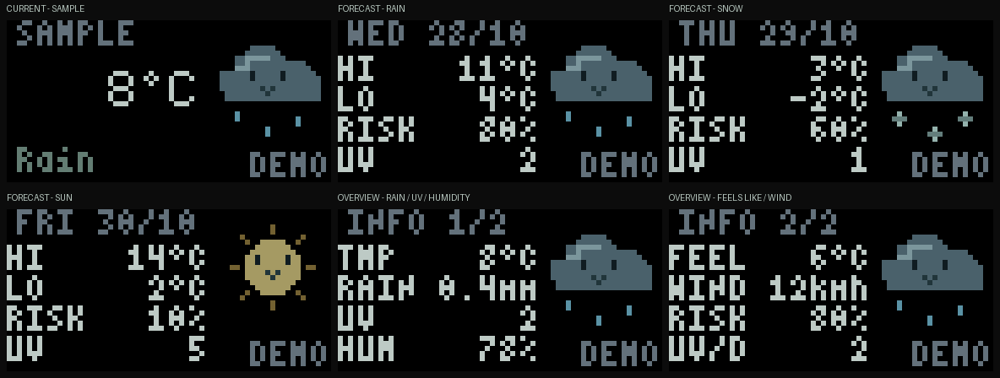

# Animated live weather

The weather app uses [wttr.in's JSON API](https://github.com/chubin/wttr.in#json-output)
for current conditions and a three-day forecast. One response supplies every
view. The muted grey/mint text stays on black, with a small animated character
in the upper-right corner: falling rain, drifting snow, sun, cloud, fog or moon.

With Python **3.12 or newer**, install the host dependencies and run:

```sh
python -m pip install -r tools/requirements.txt
python tools/run.py weather
python tools/run.py weather --location London
# Windows example; py can replace python:
python tools/run.py weather --port COM6 --location London
```

Omitting `--location` lets wttr.in choose a location from your public IP; use an
explicit city or coordinates for predictable results. `--port auto` selects
native USB. Run one host app per display. The old `tools/weather.py` launcher
and Windows `tools\weather.cmd` remain supported.

## Views and controls

| Input | Action |
| --- | --- |
| Up / Down | Cycle current weather, forecast and information overview |
| Left / Right in forecast | Select one of three forecast days |
| Left / Right in overview | Switch the two information sheets |
| Back (B) | Return to the board's local menu |

The current view shows temperature and condition. Forecast shows the selected
day's high, low, maximum precipitation probability and maximum UV. Overview
shows temperature, precipitation in mm, current UV and humidity; its second
sheet shows feels-like temperature, wind in km/h, daily precipitation probability
and daily maximum UV. Precipitation probability includes rain and snow. Forecast
artwork follows the selected day's representative midday condition.

Text has fixed positions and reserved widths. The main temperature reserves six
medium-font cells, including the minus sign and `°C`. Overview values align to a
fixed right edge; `1%` and `100%` keep their units in place. Unknown readings show
`--` with their units. Missing values never become zero.

The animation uploads at eight updates/s by default, with acknowledgement
backpressure and cached unchanged text. HTTP runs on one background worker,
outside rendering. Page changes publish atomically without reopening Canvas;
pressing Back keeps the local menu visible. `--fps` changes upload rate, while
animation speed follows elapsed time. Older firmware without button support can
still display a view selected with `--view now|forecast|info`; `--no-buttons`
disables button polling explicitly.

## Requests, cache and failures

The default provider interval is **30 minutes**. `--refresh` accepts seconds with
a **15-minute minimum**. Animation, D-pad presses, USB reconnects and app restarts
do not force another request. Failed requests back off from the configured
interval, doubling up to six hours (or the configured interval if longer).
An eight-second HTTP timeout and a bounded response size limit provider work.

Per-location cache and retry state persist in the OS user cache directory:

- Linux: `$XDG_CACHE_HOME/displaitor/weather`, or `~/.cache/displaitor/weather`.
- Windows: `%LOCALAPPDATA%\Displaitor\weather`.

`--cache-dir PATH` overrides that location. Atomic replacement and a short-lived
lease prevent simultaneous apps sharing that cache from duplicating requests.
The next request time is saved before HTTP, so a crash does not cause a retry
loop. The cache contains provider readings and the resolved location; it is
local and is not part of the repository.

The small bottom-right marker reports freshness since the last successful fetch:

| Marker | Meaning |
| --- | --- |
| LIVE | Cached provider response is within the freshness window |
| OLD | Refresh failed or data aged; last good readings retained for up to six hours |
| WAIT | Waiting for the first response |
| ERR | No usable reading and the request failed |
| DEMO | Explicit offline sample data |

After six hours without success, numeric readings disappear. No sample weather
is substituted when the provider is unavailable. Provider observation times may
precede fetch time; `LIVE` describes the fetch, not a measurement on this board.

## Offline samples and previews

```sh
# All views and D-pad controls, with explicit sample values and no HTTP:
python tools/run.py weather --demo
# Supplied values select manual mode, also without HTTP:
python tools/run.py weather --status 'Rain soon' --temperature '18°C'
python tools/run.py weather --status Snow --temperature='-2°C'

# Capture actual Rust Canvas text without contacting hardware or wttr.in:
cargo build -p simulaitor --no-default-features
python tools/run.py preview weather --output-dir target/weather-views
# Original individual condition gallery:
python tools/run.py weather --preview-dir target/weather-conditions
```



The preview exporter writes a gallery, individual PNGs and animated GIFs. All
artwork is RGB565-quantized; text comes from the real Rust renderer. “Rain soon”
selects a cloud with falling drops; snow selects a cloud with drifting flakes.
Unknown or negated descriptions use neutral dots. There are no whole-panel
lightning flashes.

The existing typed `Weather` interface remains available to other scripts:

```python
from tools.canvas import Client
from tools.weather import Weather

weather = Weather(temperature="18°C", status="Rain soon")
with Client("COM6") as display:
    weather.install(display)
    weather.update(display, 0.125, temperature="-2°C", status="Snow")
```

Update text and artwork together through `Weather.update`. This manual interface
does not fetch weather. The static `tools/displaitor_tools/resources/layouts/weather.json` is also a
supplied layout example; loading it alone does not start the live app.

Offline tests cover provider parsing, missing readings, refresh budgets,
persistent retry state, concurrent requests, failed caches, expired data, D-pad
navigation, fixed field widths and actual Canvas rendering. The new live views
have not been tested on physical hardware; earlier manual weather animations
and palette were confirmed on the panel.
